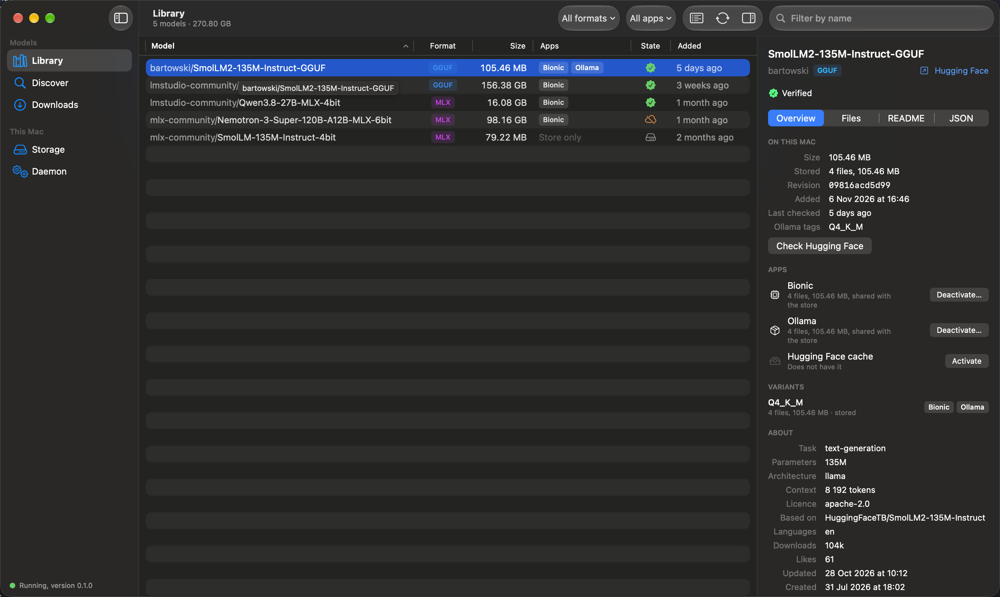

# dedupd

**dedupd** /diːˈduːpt/, pronounced *deduped*.

One copy of each AI model on disk, shared by every app that runs it.



Ollama, Bionic and LM Studio, the MLX tools, llama.cpp and `huggingface_hub` clients each keep their own copy of a
model in their own folder. A model used by several apps is therefore stored several times.

dedupd is a daemon that keeps each model file once, in a content-addressed store, and gives every app a *clone* of
it. To the app a clone is an ordinary file in the expected place; on disk it shares its blocks with the stored file
and takes no additional space. dedupd also acts as a local endpoint for Hugging Face tools and Ollama, and comes
with a command line and a macOS app.

## Features

- **One download for every app.** `dedupd pull org/repo:Q4_K_M --for ollama,bionic` downloads a model once and
  activates it in both apps as clones.
- **Adoption of existing models.** Models the apps already hold are taken into the store without changing the apps'
  files. Duplicate copies are then replaced by clones, which frees their space.
- **A store, not a cache.** Downloaded models are kept and verified against their sha256. They remain available when
  Hugging Face is unreachable or a model is removed there.
- **A local endpoint.** Hugging Face tools and Ollama can download through the daemon, which answers from the store
  and fetches what it does not have.
- **App profiles.** For each app, dedupd knows which formats it takes, by which method and at what cost in disk
  space, and states this before a model is activated.
- **An archive disk.** Every stored file is also copied to a second disk. A single model can be archived off the
  internal disk and restored later.
- **Explicit removal only.** Cleaning up, deactivating and archiving list what they would remove and act only on
  confirmation.

## Status

| | |
|---|---|
| Version | 0.1.0 |
| Platform | macOS 26 on Apple silicon |
| Apps | Ollama; Bionic and LM Studio; the Hugging Face cache (`hf`, `huggingface_hub`, `mlx_lm`, llama.cpp) |
| Model source | Hugging Face |
| Distribution | A notarised disk image of the app on the [releases page](https://github.com/descoped/dedupd/releases); the command and the daemon are inside it. Or built from source |
| Planned | A catalogue of model families and editions, ModelScope as a second source, and Linux with NVIDIA GPUs. See the [roadmap](docs/roadmap.md) |

## Requirements

- macOS 26 on Apple silicon.
- A file system with copy-on-write file cloning. On macOS this is APFS.
- The dedupd store and the applications' model directories on the same volume. A clone cannot span volumes.

dedupd does not substitute symbolic links, hard links or copies when cloning is unavailable.

## Install

Download `dedupd-<version>.dmg` from the [releases page](https://github.com/descoped/dedupd/releases), drag Dedupd to
Applications and open it. It runs in the menu bar. Install the background service with the `dedupd` command the
app carries, which copies itself to `~/.dedupd/bin` and registers a launchd agent:

```sh
/Applications/Dedupd.app/Contents/Helpers/dedupd install
```

The Install button on the app's Daemon screen runs the same command; it has been tested only against a simulated
agent so far.

## Build and try

```sh
cargo build --release                 # the command: target/release/dedupd
target/release/dedupd adopt           # adopt the models the apps already hold
target/release/dedupd status          # store contents and shared space
target/release/dedupd install         # run the daemon as a login service
target/release/dedupd pull bartowski/SmolLM2-135M-Instruct-GGUF:Q4_K_M --for ollama,bionic
```

The macOS app needs Xcode and `brew install xcodegen swiftlint just`:

```sh
just app-run                          # build the app and start it in the menu bar
```

## Documentation

- [How it works](docs/how-it-works.md): architecture, requirements, the store, clones, placement, the archive disk.
- [The macOS app](docs/app.md): the screens, with pictures.
- [The command line](docs/command-line.md): command reference and settings.
- [Apps and formats](docs/apps.md): compatibility per application and format, cost in disk space, limitations.
- [Development](docs/development.md): building, testing and code layout.
- [Roadmap](docs/roadmap.md): what is available and what is planned: the catalogue, ModelScope, Linux with NVIDIA GPUs.

## Licence

[MIT](LICENSE). Copyright © 2026 Descoped.

The models you download keep their own licences.
