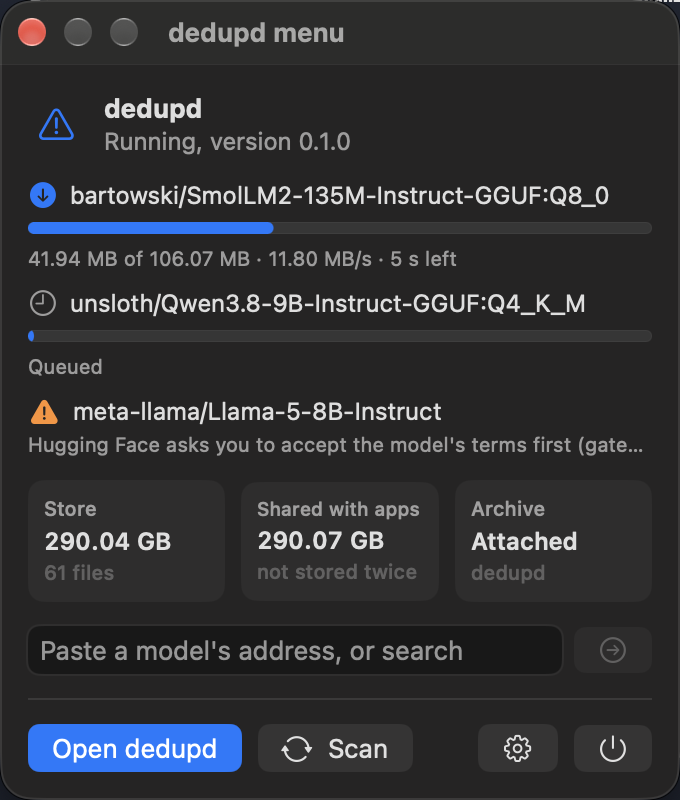
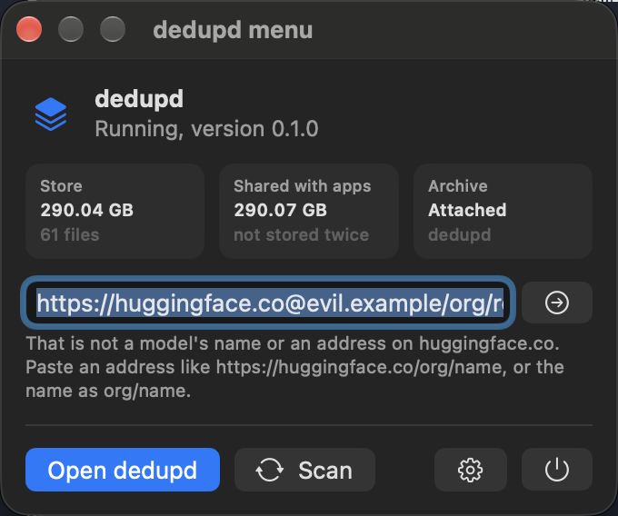
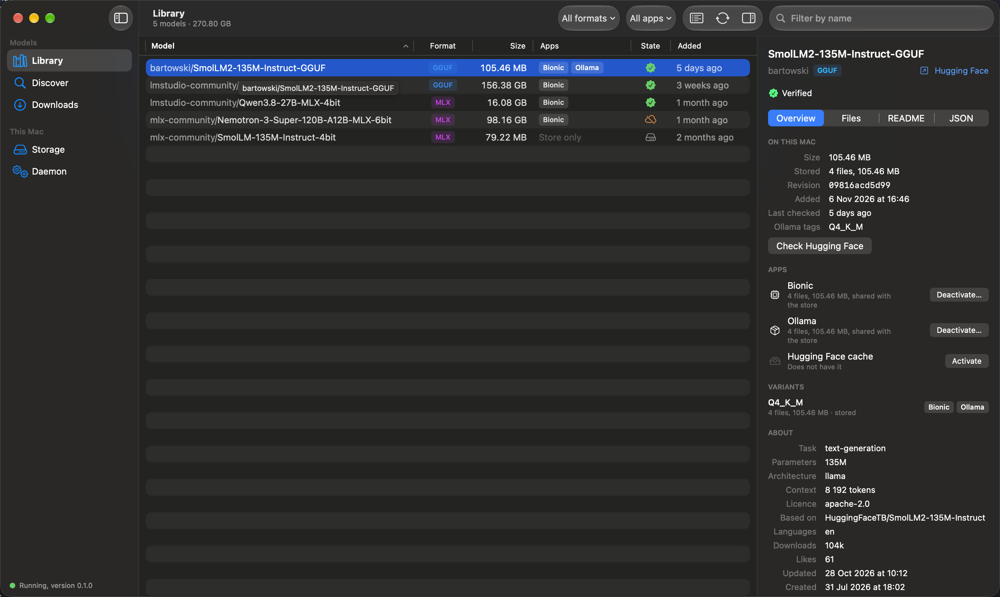
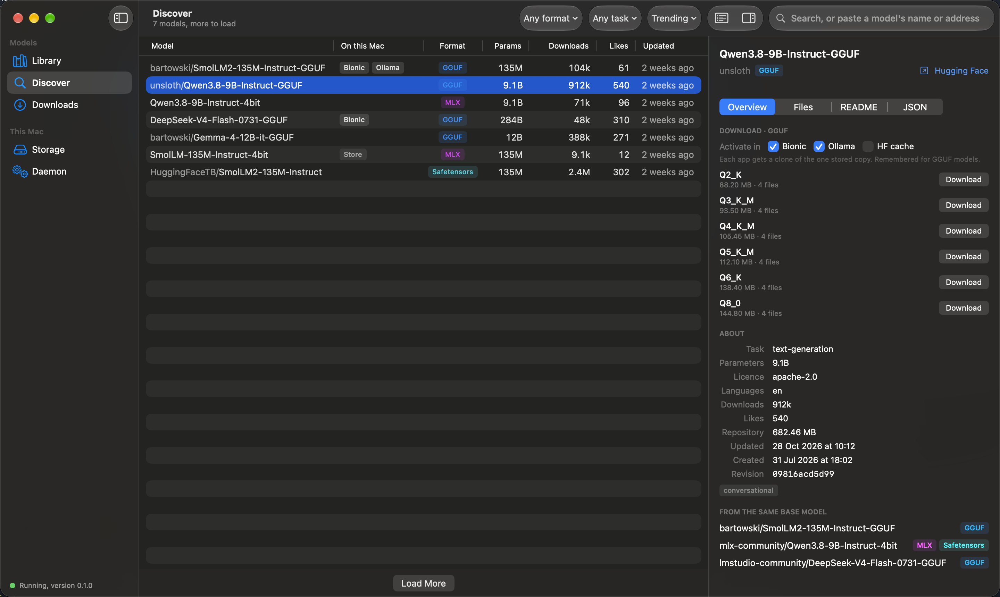
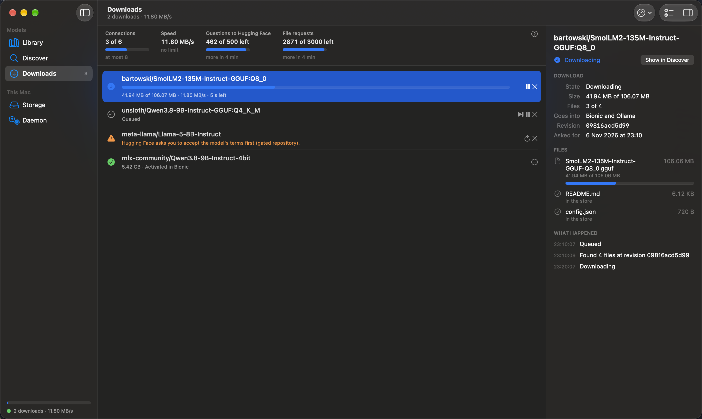
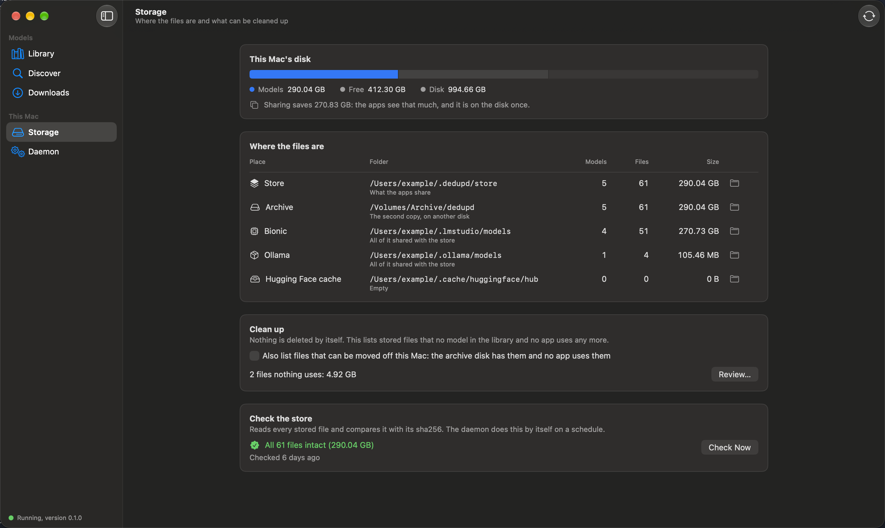
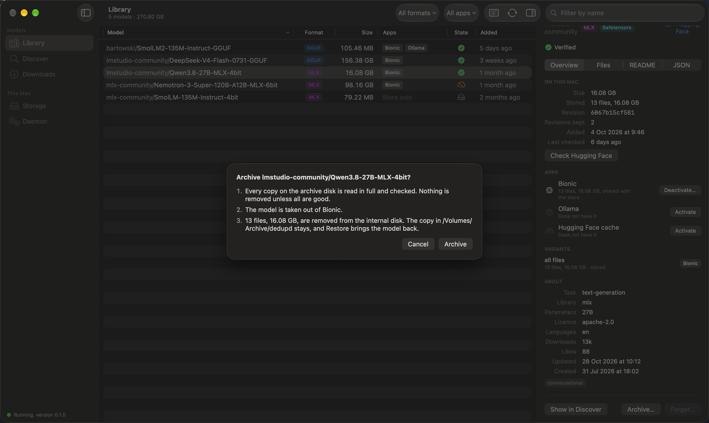
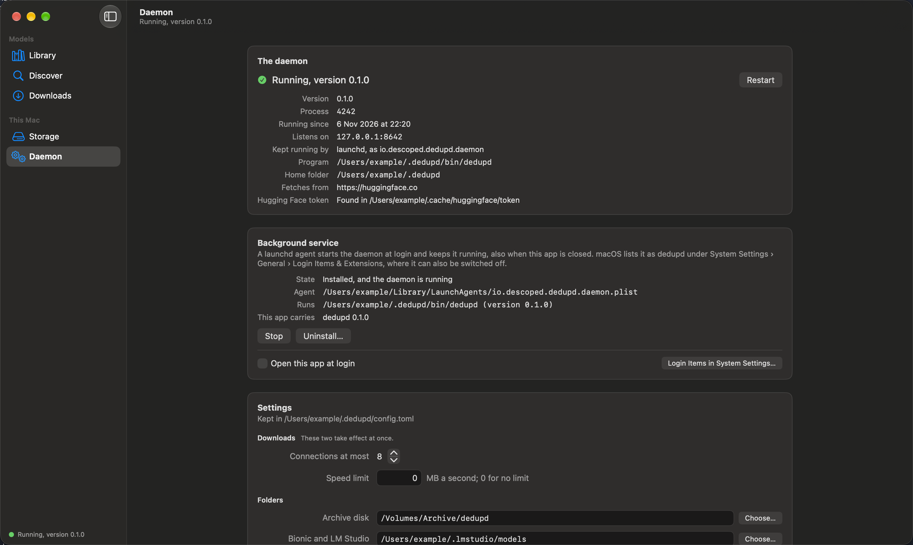
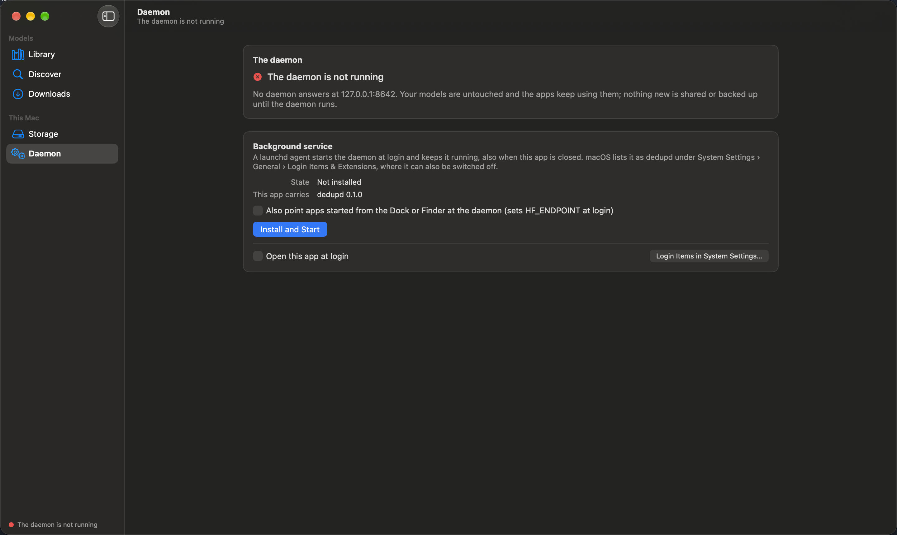

# The macOS app

The app is a menu bar app for the dedupd daemon. It shows what the daemon holds and is used to find, download,
activate, archive and restore models. The app holds no model data: everything it shows comes from the daemon, and
the daemon continues to run when the app is closed or quit.

Requirements: macOS 26 on Apple silicon. The app is distributed as a notarised disk image on the
[releases page](https://github.com/descoped/dedupd/releases), and can be built from source with `just app-run`.

The pictures on this page were taken with sample data.

## The menu bar panel

The menu bar icon opens a panel with the daemon's state, the downloads in progress, the size of the store, how
much of it the apps share, and whether the archive disk is attached.

The field takes a model's address or its name. Paste `https://huggingface.co/org/name` (or `hf.co/org/name`, or
just `org/name`) and press Return: the main window opens on Discover with that model. A few words search instead.

Pasted text is read strictly. Only an address on `huggingface.co` or `hf.co` counts, and only the model's name is
taken from it. Anything else that looks like an address is refused and sent nowhere:

## Library

The models on this Mac: their format, their size, the apps each one is in, and whether its files are verified
against Hugging Face. The inspector shows one model in full. Activate puts it into an app as clones; Deactivate
takes it out again and leaves the stored copy.

## Discover

Search Hugging Face, or paste a model's name or address into the search field. The list says which models are
already on this Mac. The inspector shows a model's variants with their sizes; Download fetches one variant once
and activates it in the apps you ticked.

## Downloads

The queue. A download can be paused, continued, retried, started ahead of the others and cancelled, and it
survives a restart of the daemon. The figures at the top show the request budget Hugging Face allows; dedupd
adjusts its rate to the limits the source reports. A download that requires action, such as a gated model whose
terms have not been accepted, states what is required.

## Storage

Where the files are, and how much space sharing saves. Clean up lists stored files that are no longer referenced
and removes them only after the list has been confirmed. Check the store reads every stored file and compares it with its sha256.

## Archiving a model

With an archive disk set, a model can be moved off the internal disk. The app says what will happen before it
does anything, and nothing is removed unless every copy on the archive disk has been verified. Restore brings the model
back.

## Daemon

The background service: install it, update it, stop it, start it, uninstall it. The settings on this screen are
the ones in `~/.dedupd/config.toml`.

When no daemon is running, the app reports it and offers to install the bundled daemon. Existing models are not
affected.

